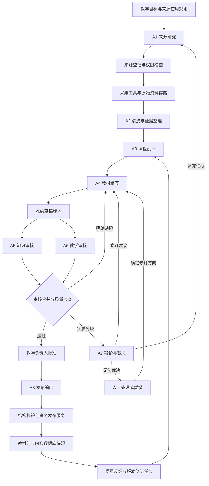

# 教学材料数据库：多智能体联动体系 MVP 提案模板

> 项目暂名：Teaching Materials Foundry（教学材料生产与审核系统）  
> 版本：v0.1｜日期：2026-10-02｜状态：待评审提案  
> 项目负责人：[填写]｜教学负责人：[填写]｜技术负责人：[填写]  
> 本文交付架构和实施模板；采集、Agent、数据库建设与上线均为拟实施内容。所有数量、分数、预算和周期均为建议目标，尚非实测结果。

> 实施进展：本模板保留原始提案基线。当前已实现独立工作台，并完成首批12单元、72张教学卡、72道练习的实际编辑与独立审核。实际交付、验证和待办见[首批教材库质量报告](../materials-workspace/editorial-v1/QUALITY_REPORT_ZH.md)；提案目标不等于已达成规模或发布批准。

## 1. 项目主张

建立一个独立的教学内容生产系统，将**官方教材与标准的知识依据**和**中外主流社交媒体的真实语言场景**转化为可追溯、可审核、可版本化、可检索的高品质教材数据库。

完整业务闭环：

**确定教学目标 → 选择与采集来源 → 清洗与证据整理 → 设计教学单元 → 编写教材与练习 → 独立审核 → 分歧辩论与裁决 → 教学负责人批准 → 发布教材与数据库 → 根据质量反馈修订。**

关键产物既包括面向教师和学习者的教材包，也包括供 GoalCoach 等教学应用消费的结构化数据库。数据库是质量闭环的发布结果，不能把原始采集内容直接视为教材。

### 1.1 与 GoalCoach 的边界

| 子系统 | 职责 | 边界 |
|---|---|---|
| 本提案：教材生产系统 | 获取材料、建立证据、编制教材、审核、发布、撤回 | 独立运行，拥有生产工作库和内容发布权限 |
| GoalCoach Planning Agent | 根据用户目标和学习状态安排学习 | 消费已发布概念与先修关系 |
| GoalCoach Teaching Agent | 根据学习进度组织教学交互 | 消费已发布教学卡与练习 |
| GoalCoach Grading Agent | 对学习者作答进行判断和反馈 | 消费练习答案、可接受答案与评分依据 |
| 学习者状态数据库 | 保存学习进度、错误记录、会话 | 不属于教材生产数据库；后续质量反馈采用明确的脱敏接口 |

本次核对的现有代码与 SQL 种子文件已包含 `curriculum_concepts`、`teaching_cards`、`exercises`、`concept_prerequisites` 四类内容表，可作为兼容导出的目标。该核对不代表当前运行中的数据库已通过质量审计。

独立运行不要求第一阶段拆成多个微服务。建议先实现一个有明确领域边界的 Python 应用，以批处理方式生产教材，再通过经过验证的发布包对接 GoalCoach。

### 1.2 需要解决的具体问题

1. 官方教材有结构和规范，但真实生活中的表达、语域和使用情境需要补充。
2. 社交媒体能提供场景与学习者困惑，但存在错误、广告、个人信息、断章取义和重复传播。
3. 单个生成 Agent 容易把“说得自然”误当作“知识正确”，或生成看似合理但答案含混的练习。
4. 多个 Agent 的一致意见仍可能来自同一个错误来源，必须保留证据和独立审核。
5. 没有版本和来源记录的教材库，难以纠错、解释评分、撤回内容或稳定接入教学产品。

## 2. MVP 范围与可填写参数

| 项目 | 建议默认值 | 项目确认值 |
|---|---|---|
| 教学领域 | 面向成人初学者的汉语；教学语言中文，辅助解释英文 | [填写] |
| 等级体系 | 选定一个 HSK 标准版本并建立映射；启动前确认 | [标准名称、发布机构、版本、日期] |
| 首批主题 | 问候、自我介绍、购物、点餐、交通等 10 个沟通主题 | [填写] |
| 首批规模 | 30 个概念、每概念 4–6 张教学卡和 4 道练习 | [填写] |
| 正式知识来源 | 1 套有明确使用依据的教材 + 1 份相关官方标准或大纲 | [来源与版本] |
| 国内社交媒体 | 1 个平台，限定账号、频道或主题白名单 | [填写] |
| 国外社交媒体 | 1 个平台，限定账号、频道或主题白名单 | [填写] |
| 候选采集规模 | 正式材料按章节切分；社媒最多 200 条候选记录 | [填写] |
| 数据形式 | 文本、教材 PDF 的授权文本提取、可合法取得的字幕 | [填写] |
| 发布产物 | 中文说明的教材 Markdown 包、JSONL、SQLite 内容快照、来源与审核报告 | [填写] |
| 内容形态 | 核心教材、语境补充、教师备注；分别标记用途 | [填写] |
| 审核方式 | 两路独立审核、按需辩论、首次发布逐单元人工批准 | [负责人] |
| 试点周期 | 4 周，前提是资料与权限已就绪 | [起止日期] |
| 成本约束 | 单概念最多 20 次模型请求、单批最多 60 美元，均为可配置初值 | [币种、上限] |

MVP 不包含全网持续抓取、所有 HSK 等级、完整音视频下载与生成、大规模个性化教材、在线自主改写已发布教材。音频、图像及视频素材生产可在后续独立扩展。

## 3. 来源策略：知识规范与真实语境分开评价

### 3.1 来源分层

| 层级 | 来源候选 | 用途 | 发布条件 |
|---|---|---|---|
| A：官方标准与课程文件 | 标准发布机构、考试机构、教育主管部门的正式文档 | 等级、范围、能力目标的依据 | 核对发布者、版本、页码和适用范围 |
| B：经核验的正式教材 | 出版社、作者或机构提供的教材及配套资料 | 语法解释、知识组织、教学顺序 | 核对书名、ISBN、版次及允许的使用方式 |
| C：专业教学内容 | 机构账号、教师内容、专业语言解释 | 补充讲解和典型问题 | 逐项核验，不因认证或职业身份自动通过 |
| D：一般社交媒体 | 日常帖子、评论、公开字幕、生活场景 | 发现表达、语域、误区和需求 | 标注场景、时间、地域及可信度；不单独证明规范规则 |

“正式出版”不自动等于“官方指定”。来源登记必须区分官方标准、正式教材和个人教学内容。

国内候选：Bilibili、知乎、小红书、微博、微信公众号、抖音。国外候选：YouTube、Reddit、Instagram、TikTok、X。**这些是选型候选，不表示已验证存在可用 API、已获得抓取权限或能批量访问。** MVP 从中各选一个具备稳定合法获取方式的平台。

### 3.2 获取策略与来源登记模板

优先使用官方 API、机构授权导出、开放许可数据、创作者提供的材料和用户有权导入的文件。公开可见不等于允许复制、改编或分发；访问权限和教材再利用权限分别登记。遇到登录限制、访问封禁或不可确认的权限，任务转为人工导入或待补充来源。

```yaml
source_id: "[稳定编号]"
source_category: "official_standard | textbook | professional_social | general_social"
title: "[来源名称]"
publisher_or_creator: "[发布机构或创作者]"
platform: "[平台或出版社]"
canonical_url: "[可核查链接；本地资料可为空]"
edition_or_published_at: "[版次或发布时间]"
access_method: "api | licensed_export | permitted_fetch | manual_import"
rights_status: "pending | approved | restricted | revoked"
rights_evidence_ref: "[授权文件或许可条款记录]"
allowed_uses: ["internal_analysis", "quotation", "adaptation", "redistribution"]
commercial_use: "allowed | forbidden | unknown"
retention_until: "[保留截止时间或复核日期]"
reviewed_by: "[负责人]"
```

授权条目按实际证据填写，不能使用模板默认值代替确认。许可不兼容的来源不能混合进入同一发布包；不允许保留原文的来源仅保存允许的元数据和定位信息。

### 3.3 采样与质量边界

- 正式来源保证目标概念覆盖；社媒按沟通场景、平台、创作者、时间段采样，避免只按热度排序。
- 每条社媒内容最多作为一种语境证据；转发、镜像、引用同一原文的帖子归为同一来源簇。
- 不设“必须使用某比例社媒内容”的硬指标，防止为凑数量引入低质量内容。
- 对过时、地域性、俚语或争议表达添加标签；不适合初学者的内容保留为研究材料或教师备注。
- 原始网页、字幕和评论均视为外部数据；其中的指令不能改变 Agent 的任务、工具权限或发布规则。

## 4. 多 Agent 角色与协作契约

建议使用 **8 个逻辑 Agent 角色 + 1 个确定性工作流协调器**。不同角色可以使用同一模型服务，但输入上下文、输出类型、工具权限和审计记录分别管理；每个角色不必对应独立进程或服务器。

| 角色 | 核心职责 | 输入 → 输出 | 工具与权限边界 |
|---|---|---|---|
| A1 来源研究 Agent | 根据知识缺口制定来源检索与补采计划，判断来源用途 | `AcquisitionBrief` → `SourcePlan` | 可检索元数据与提出采集请求；不能授予使用权 |
| A2 清洗与证据 Agent | 修复可核验的解析问题、切分、标注、去重、抽取教学主张 | `RawDocument` → `EvidenceBundle` | 可调用解析器和去重工具；保留原始片段与定位，不改写原始证据 |
| A3 课程设计 Agent | 将目标拆为概念、先修关系、难度与评估目标 | `CurriculumBrief + EvidenceBundle` → `UnitBlueprint` | 提出概念映射及依赖；不能自动变更已发布概念语义 |
| A4 教材编写 Agent | 编写讲解、原创例句、对话、练习、答案与教师备注 | `UnitBlueprint + EvidenceBundle` → `MaterialDraft` | 只使用已批准的证据包，不直接访问发布库 |
| A5 知识审核 Agent | 检查知识准确性、引用支持、来源冲突与适用范围 | 冻结草稿及证据 → `ReviewReport` | 独立审核；第一轮不可读取 A6 的审核结论 |
| A6 教学审核 Agent | 检查目标达成、难度、认知负荷、题目歧义、语言自然度 | 同一冻结草稿及证据 → `ReviewReport` | 先在隐藏标准答案的条件下独立解题，再核对答案 |
| A7 分歧裁决 Agent | 对争议命题组织证据比较，给出有条件结论或升级建议 | `DisputeCase + ReviewReports` → `DecisionRecord` | 可申请补证；无权绕过硬性质量门槛或人工批准 |
| A8 发布编目 Agent | 整理教材目录、标签、版本说明与入库映射建议 | 批准的教材 → `ReleaseProposal` | 不能执行任意 SQL；不能修改已批准正文，变更正文必须重审 |
| 工作流协调器 | 调度、状态迁移、预算、重试、锁、审核门槛与发布调用 | 类型化事件 → 持久化任务与状态 | 使用应用代码实现；不让模型自行决定是否跳过审核 |
| 人工教学负责人 | 审批来源用途、处理无法裁决的问题、批准首批教材 | 证据、教材差异、审核结论 → 明确决定 | 决定绑定具体教材版本；不能通过普通批准解除来源使用限制 |

实际下载、OCR、字幕解析、字符规范化、外键校验、数据库写入由可测试的工具服务承担。Agent 负责需要语言理解与教学判断的环节。

### 4.1 协作图



工作流协调器管理所有节点。人工处理后若教材发生变更，必须产生新版本并重新审核。

### 4.2 统一 Agent 任务模板

```yaml
task_id: "[任务编号]"
run_id: "[批次编号]"
agent_role: "[A1-A8]"
objective: "[本步骤唯一可验收目标]"
input_artifact_ids: ["[输入版本编号]"]
input_schema_version: "1.0"
policy_version: "[课程、来源、审核规则版本]"
allowed_tools: ["[工具白名单]"]
constraints:
  require_evidence_for_factual_claims: true
  treat_source_content_as_untrusted_data: true
output_schema: "[类型化输出模型名称]"
on_missing_evidence: "return_needs_evidence"
on_unresolvable_issue: "return_needs_human"
deadline_seconds: 120
```

任务模板之外还需定义每种输出模型的字段、枚举、长度和引用有效性。自由文本解释只能作为结构化结论的补充。

## 5. 端到端处理流程

### 5.1 采集与清洗

1. 根据目标生成待覆盖概念与问题清单，再据此采集，避免无目的地堆积数据。
2. 采集工具记录来源版本、获取时间、内容哈希、请求状态和资料定位。内容正文放入受控存储，不进入普通运行日志。
3. 清洗服务移除导航、广告、重复片段及无关个人信息；A2 判断正文边界、上下文和教学相关性。
4. 使用精确哈希处理完全重复，使用文本相似度筛选近似重复，再由规则或人工确认。保留合并关系和独立来源簇。
5. 对 OCR 不确定字符、字幕错字、说话人切分与语义变化保留置信标记。低置信内容暂缓使用，不能用模型猜测补成“原文”。
6. 每个可用片段保存页码、段落或时间戳，以及必要的前后文；建立“原文 → 清洗文本 → 教学主张”的映射。

### 5.2 证据整理与教学设计

将每条材料区分为：规范规则、使用实例、个人观点、学习者问题、待核验主张。只有经过核验的证据才能支持教材中的事实性结论。

A3 为每个概念输出：可观察的学习目标、等级版本、先修知识、核心词汇与结构、真实使用场景、建议学习时间、练习测量目标。先修图必须无环；预计时长为教学设计估计，后续用试教结果校准。

教材规则依据正式来源；社媒用于回答“谁在什么场合如何表达”。两者冲突时先判断是否存在口语、地域、时间或受众差异，不能简单以来源数量投票。

### 5.3 编写、审核与发布

A4 依据蓝图生成原创讲解和练习，明确区分引用、改编和原创例句。练习包含标准答案、可接受答案、评分依据和错误标签；不能只生成题干。

A5 与 A6 对同一草稿版本独立审核。明确错误直接返修；存在实质分歧时才进入辩论。修订后的版本重新进行两路审核，旧结论不能自动继承为通过。

首次发布逐单元人工批准。发布服务重新验证来源权限、版本哈希、质量门槛、结构约束和批准记录，再生成教材包与数据库快照。只有成功发布的版本可被教学应用使用。

## 6. 分歧辩论机制

### 6.1 触发条件

- 两个审核 Agent 对同一主张分别给出“通过”和“阻断”。
- 正式来源之间存在版本或解释冲突，无法直接确认适用范围。
- 题目存在多个合理答案，编写者与审核者对评分边界意见不同。
- 社媒用法与教材表述不同，可能需要增加语域限制而不是删除表达。
- 审核分数差异只作为线索；单纯分数不同但没有具体争议命题，不触发辩论。

### 6.2 辩论规则

每个 `DisputeCase` 只处理一个明确命题，保存：命题、受影响的内容字段、两方观点、证据定位、反例、适用范围、建议处理及剩余不确定性。

1. **第一轮：独立举证。** A5、A6 提交观点；A4 可以说明设计意图，但不能以自身解释代替来源证据。
2. **第二轮：定向反驳。** 针对对方证据和反例回答，可提出一次定向补采需求。
3. **裁决：** A7 输出 `accept / revise / exclude / needs_human`，逐项说明依据和限制。
4. **停止条件：** 每个争议最多两轮论证、一次补采；触达上限、预算耗尽或仍缺乏可靠证据即交人工或暂缓。重新运行不得自动重置该争议预算。
5. **回到生产流程：** 需要修订时由 A4 创建新版本；A5、A6 重新审核。裁决不是发布批准。

不得以多数票、措辞强度或模型自报置信度作为事实成立的依据。多模型配置可降低部分共同偏差，但不能取代独立证据。

### 6.3 示例：社媒表达是否适合核心教材

争议命题：“能否向初学者讲解‘吃了吗？’等于英语中的通用 Hello？”

知识审核提出：直接等同可能过度概括，需要来源支持和情境限制。教学审核提出：可以帮助理解真实交际，但必须解释交谈对象、场景和可能的字面含义。

可能的处理方案是把“你好”作为基础问候，将“吃了吗？”放入带语境说明的补充卡，并避免设计脱离语境的唯一答案题。**此处仅演示争议处理方式，不构成已核验的教材结论；实际发布仍需真实证据。**

## 7. 高品质教材的定义与验收

### 7.1 必须全部通过的发布门槛

- 来源使用权限满足该发布场景；已撤销或用途不明的来源不能进入发布版本。
- 每条事实性主张都有可定位且经审核确实支持它的证据；原创例句标记为原创，并关联其教学依据。
- 语法、语义、拼音、翻译、答案及解析之间不存在已知矛盾。
- 选择题在给定语境下有唯一最佳答案；开放题有明确评分边界与可接受表达。
- 不存在未关闭的阻断问题、未完成辩论或必需但缺失的人工决定。
- 教材版本、审核版本、批准版本和待发布哈希完全一致。
- 所有概念引用有效，先修图无环，排序与唯一性约束通过，教材包和数据库内容一致。

### 7.2 建议评分卡

| 维度 | 权重 | 审核问题 |
|---|---:|---|
| 知识与答案准确性 | 30 | 规则、解释、例句和答案是否正确？ |
| 教学目标与可学性 | 25 | 初学者能否理解，练习能否测量目标？ |
| 证据与引用质量 | 20 | 证据是否真实、可追溯且支持具体主张？ |
| 难度与先修匹配 | 15 | 是否引入未讲解的结构，认知负荷是否合理？ |
| 场景真实性与表达自然度 | 10 | 场景是否可信，语域与文化解释是否适当？ |

每维按 0–5 分评分，最终分数为 `Σ（该维得分 ÷ 5 × 权重）`。建议发布分数不低于 85/100，且每维不低于 3/5。硬性门槛失败时，总分再高也不得发布。

试点阶段分别记录 A5、A6 的评分，按每维较低分计算保守总分；若发生裁决，最终维度分须由人工负责人确认，并保留原评分。评分阈值用教师标注样本校准，不能把模型打分当成客观质量证明。

### 7.3 MVP 验收指标与测量方法

| 指标 | 建议目标 | 测量方法 |
|---|---|---|
| 首批发布规模 | 30 个概念、120–180 张卡、120 道练习 | 对发布清单计数；数量不足不能通过降低标准补齐 |
| 来源可追溯率 | 100% | 对发布内容检查证据引用、定位和权限记录完整性 |
| 独立审核覆盖率 | 100% | 每个发布单元存在 A5、A6 对应版本的报告 |
| 首批人工批准覆盖率 | 100% | 每个发布单元绑定教学负责人批准记录 |
| 未解决阻断项 | 0 | 发布前查询问题与争议状态 |
| 严重错误漏检 | 冻结评测集中为 0 | 教师准备至少 20 个缺陷案例，检查错误答案、虚假引用、越级和来源冲突的拦截结果 |
| 正常内容误拦截 | 建议不超过 20% | 另设至少 20 个教师认可案例，统计错误阻断；与缺陷集分开报告 |
| 可用性 | 小规模试教后确认 | 邀请约 5 名目标学习者体验，记录困惑与完成情况；不据此声称学习效果已得到统计验证 |
| 稳定性与回滚 | 故障用例全部通过 | 重试、重复提交、并发发布、断点恢复、权限撤销与旧版本恢复演练 |
| 成本与耗时 | 落在确认预算内 | 报告每概念成本、请求次数、总耗时、人工审核时间和返修率 |

评测样本在调试前冻结，开发样本与验收样本分开。小样本上未发现严重错误不代表生产环境错误率为零。

## 8. 数据库设计：生产工作库与发布内容库

### 8.1 数据分层

| 层 | 内容 | 建议存储 |
|---|---|---|
| 原始资料层 | 获准保存的原文、PDF、字幕与获取记录 | 本地受控文件目录；规模扩大后迁移对象存储 |
| 证据与生产层 | 来源、片段、主张、草稿、审核、辩论、任务 | MVP 单写入者 SQLite 工作库；多用户并发时评估 PostgreSQL |
| 已发布内容层 | 审批通过的概念、卡片、练习、先修关系及版本 | 每个 release 独立 SQLite 快照 + 发布清单 |
| 检索辅助层 | 全文检索索引、可选语义索引 | 先使用 SQL / FTS；有实际检索缺口后再评估向量库 |

建议工作库命名 `materials_workbench.db`，每次发布生成 `releases/<release_id>/materials.db`。这些是拟议路径，本文不创建数据库。

### 8.2 生产工作库核心表

下表是逻辑模型，实施时通过版本化迁移建立物理结构。ID 采用稳定 UUID；版本内容不可原地覆盖。

| 表 | 关键字段与关系 | 作用 |
|---|---|---|
| `sources` | `source_id PK`、来源类型、发布者、URL、版次 | 区分标准、教材、专业内容和一般社媒 |
| `source_rights` | `rights_id PK`、`source_id FK`、用途、状态、凭据、有效期 | 权限变更与历史审计 |
| `source_documents` | `document_id PK`、`source_id FK`、哈希、存储引用、采集时间、解析版本 | 同一来源的不可变文档版本 |
| `evidence_spans` | `span_id PK`、`document_id FK`、页码/时间戳、清洗文本引用、质量标签、来源簇 | 支持精确引用、去重与上下文恢复 |
| `claims` | `claim_id PK`、命题、适用范围、核验状态 | 把知识主张与原文片段分开管理 |
| `claim_evidence` | `(claim_id, span_id) PK/FK`、`supports / contradicts / context` | 保存支持、反驳或语境关系 |
| `material_versions` | `version_id PK`、逻辑教材 ID、版本号、蓝图引用、schema 版本、内容哈希、状态 | 保存类型化教材包及其版本 |
| `material_evidence` | `version_id FK`、内容项 ID、字段路径、`claim_id FK`、使用方式 | 定位到具体卡片、练习或解释的证据链 |
| `reviews` | `review_id PK`、`version_id FK`、审核角色、模型与提示版本、评分、结论 | 保存彼此独立的审核报告 |
| `review_issues` | `issue_id PK`、`review_id FK`、字段路径、严重度、状态、修订版本引用 | 跟踪缺陷关闭；禁止靠删除问题达到通过 |
| `disputes` | `dispute_id PK`、`version_id FK`、命题、轮次、状态 | 有限辩论的生命周期 |
| `dispute_entries` | `entry_id PK`、`dispute_id FK`、角色、轮次、证据引用、观点/裁决类型 | 保存论证及裁决过程 |
| `approvals` | `approval_id PK`、`version_id FK`、内容哈希、人员、决定、时间 | 将人工批准绑定不可变版本 |
| `workflow_runs` / `workflow_tasks` | 批次、任务、幂等键、状态、尝试次数、预算使用、租约 | 可恢复调度和有限重试 |
| `releases` / `release_items` | 发布 ID、清单哈希、schema 版本、发布项版本外键、状态 | 组成固定且可审计的发布集合 |

评分明细和各类教材项可使用经 Pydantic schema 校验的 JSON 持久化，审核所需的状态、外键和索引字段独立成列。应用层不以无约束 `dict[str, Any]` 传递业务数据。

核心血缘关系为：

`来源 → 文档版本 → 证据片段 ↔ 知识主张 → 教材版本 → 审核/争议/批准 → 发布项 → 发布版本`。

### 8.3 发布库与 GoalCoach 的兼容映射

| 发布表 | 内容 | 兼容要求 |
|---|---|---|
| `curriculum_concepts` | 概念目标、难度、等级、顺序、估计时长 | 维持现有 ID 或提供明确映射，避免学习进度指向不同语义 |
| `teaching_cards` | 目标、词汇、语法、例句、提示、小对话 | 导出类型必须在现有枚举范围；新增类型需另行适配 |
| `exercises` | 题干、选项、答案、可接受答案、解释、错误标签 | 与现有模型字段和评分约定匹配 |
| `concept_prerequisites` | 概念先修边 | 所有引用存在，图无环，不生成自引用 |
| `release_manifest`（拟新增） | 发布 ID、schema 版本、构建时间、摘要 | 识别当前内容版本 |
| `published_provenance`（拟新增） | 内容类型、内容 ID、证据引用、授权说明 | 提供允许公开的来源说明；原始受限资料不随库导出 |

兼容适配器只将批准的内容映射到现有字段，并通过实际读取验证；不能依赖把所有新增语义塞进 `metadata` 来获得兼容性。

源端使用稳定的教学项 UUID；导出到现有整数 `card_id` 时保存稳定映射。同一 ID 不得被复用为不同教学含义，删除和替换通过版本与迁移规则处理。

### 8.4 约束与发布事务

- `UNIQUE(逻辑教材 ID, 版本号)`；文档去重键包括来源 ID 和内容哈希。
- 教材内卡片及练习顺序唯一，题目关联合法概念；依赖无环在应用层校验。
- 每一步保存输入版本、输出版本和策略版本；审核失效由内容哈希变化触发。
- 发布服务先在临时路径构建完整快照，检查外键、内容计数、血缘和读取兼容性，再原子地将发布状态标为可用。
- 文件与工作库无法共享同一数据库事务：先写文件并校验，再提交可用清单；崩溃遗留的未引用文件由恢复任务识别，不能被消费者看到。
- 消费者只读取清单中可用的 release，并在会话内固定版本。切换版本或恢复旧版本需维护连接生命周期，不直接覆盖正在使用的 SQLite 文件。
- 新版本失败时保留上一可用版本。版权撤销或严重错误涉及旧版本时，受影响版本全部撤回，不能把已失效的版本当作回滚目标。
- 发布前按血缘再次检查来源权限；普通运行日志只记录 ID、状态、耗时与成本，资料正文及个人信息采用受控访问。

## 9. 教材单元输出模板

以下字段同时服务于可读教材和结构化入库；最终由同一已批准数据模型渲染两种产物。

```yaml
material_id: "[教材单元稳定 ID]"
version: 1
title: "[单元名称]"
concept_id: "[概念稳定 ID]"
level_framework: "[标准名称与版本]"
level: "[目标等级]"
audience: "[学习者范围]"
learning_objective: "[学习后能够完成的可观察行为]"
prerequisite_ids: []
estimated_minutes: 8
core_content:
  vocabulary: []
  grammar_points: []
  explanation_zh: "[中文讲解]"
  explanation_en: "[英文辅助解释]"
teaching_cards:
  - item_id: "[稳定 UUID]"
    card_type: "example"
    text_zh: "[原创或获准使用的例句]"
    pinyin: "[经校验拼音]"
    meaning_en: "[英文含义]"
    register: "[正式/日常/地域性等]"
    origin: "original | adapted | quoted"
    evidence_claim_ids: ["[教学依据对应的主张 ID]"]
exercises:
  - exercise_id: "[稳定 ID]"
    exercise_type: "dialogue_choice"
    prompt: "[场景与题干]"
    options: []
    answer: "[标准答案]"
    accepted_answers: []
    grading_rationale: "[评分依据与边界]"
    explanation: "[为什么正确、常见误解]"
    error_tags: []
teacher_notes: "[限制、文化说明、典型误区]"
evidence_links: []
review_ids: []
resolved_dispute_ids: []
approval_id: "[批准记录]"
release_id: "[发布版本]"
```

以上为字段说明模板，包含占位符，不能直接作为合格发布数据。`origin` 的具体值只能选一个；选项、证据和批准记录等必填内容须根据实际教材补齐。拟议输出字段由适配器映射到 GoalCoach 的现有模型。

可读教材目录建议为：学习目标 → 先修知识 → 核心讲解 → 例句与对话 → 真实语境补充 → 练习 → 答案与解析 → 教师备注 → 来源与版本说明。

## 10. 工程实现建议

### 10.1 技术与领域边界

推荐 Python 3.12+、Pydantic v2、PydanticAI、SQLAlchemy 2 和 Alembic；具体版本在实施前依据现有项目依赖锁确认。MVP 先提供批处理 CLI 和最小审核入口，确有远程审核需求时再增加 FastAPI。

| 层 | 建议组件 | 主要职责 |
|---|---|---|
| Domain | `Source`、`EvidenceBundle`、`MaterialVersion`、`ReviewReport`、`Release` | 不可变版本、状态规则和领域约束 |
| Application | `IngestionService`、`AuthoringWorkflow`、`ReviewWorkflow`、`PublicationService` | 协作编排、事务边界和权限检查 |
| Ports | `SourceConnector`、`AgentRunner`、`EvidenceRepository`、`MaterialRepository`、`ReleaseExporter` | 使用 Protocol 定义可替换接口 |
| Infrastructure | 平台 API 连接器、文件解析器、模型适配器、SQL 仓储 | 网络和存储的具体实现 |
| Interfaces | 批处理 CLI、审核页面或审核命令、可选 HTTP API | 展示证据与版本差异，提交明确决定 |

模型和仓储经依赖注入提供。源材料、草稿和审核产物使用严格类型；所有签名满足严格类型检查目标。对外部边界定义 `SourceAccessError`、`EvidenceValidationError`、`AgentOutputError`、`PublicationConflictError` 等异常，区分可重试故障和需要业务处理的问题。

### 10.2 调度、并发和故障恢复

- 网络采集与模型请求使用 `asyncio` 和独立的并发信号量；OCR 等 CPU 密集工作使用受控进程池。
- SQLite MVP 采用一个持久化写入协调者；模型请求不能占用数据库事务。
- 任务幂等键由角色、输入哈希、提示版本、策略版本组成；数据库唯一约束防止重复提交。
- 外部请求有超时、指数退避和抖动，最多三次尝试。权限错误、业务验证失败不进行网络重试。
- 模型输出不符合 schema 时最多一次修复；事实缺失转补证或人工处理。
- 每个单元最多两轮内容返修，每个争议最多两轮辩论；所有重试和修复计入总请求与费用预算。
- 单概念请求上限和批次费用上限由协调器强制执行；调用前按最大输出额度预留预算，无法满足则暂停，避免并发请求透支。
- 使用任务租约与超时恢复处理进程崩溃；取消时释放连接、标记可恢复状态并保留已完成产物。
- 发布采用期望版本比较和事务约束；并发批准或发布冲突必须显式失败并重读状态。

### 10.3 状态机

资料状态：`registered → rights_checked → acquired → cleaned → evidence_ready`；不能继续的资料进入 `quarantined`。

教材版本状态：`draft → in_review → needs_revision / disputed / awaiting_approval → approved → published`。

`needs_revision` 产生新的 `draft` 版本；原版本保留历史。`disputed` 经裁决进入修订、人工处理或暂缓。`awaiting_approval` 被拒绝后进入修订或淘汰。

异常分支包括 `needs_evidence`、`needs_human`、`paused_budget`、`rejected` 和 `withdrawn`。只有在对应条件得到解决后，协调器才允许恢复；不能通过模型文本自行跳转到 `approved`。

### 10.4 需要权衡的选择

| 选择 | MVP 决策 | 代价与升级条件 |
|---|---|---|
| 多 Agent 与成本 | 两路审核，辩论按需触发 | 比单 Agent 更贵；先测量严重错误拦截收益 |
| 独立角色与多模型 | 先隔离上下文；关键审核可配置不同模型 | 同模型可能共享盲点；是否引入第二供应商由评测决定 |
| 自动化与人工质量责任 | 首批逐单元批准 | 吞吐受教师时间限制，但可形成校准样本 |
| SQLite 与 PostgreSQL | 工作库单写入者 SQLite、发布不可变快照 | 多人并发编辑、分布式 worker 出现后迁移 PostgreSQL |
| SQL 与向量检索 | 先结构化检索和全文检索 | 自由语义召回不足且有测量证据后增加向量索引 |
| 动态生成与结果可审计 | 固定输入、模型配置、提示版本和产物 | 可追踪过程，但不承诺模型重跑逐字一致 |

## 11. 四周实施计划

人员假设：1 名后端/Agent 工程师、1 名具备目标领域能力的教学负责人；平台与资料权限已就绪。若权限未就绪，先完成接口与人工导入，不能声称已完成社媒连接器。

| 阶段 | 工程交付 | 教学与数据交付 | 完成标准 |
|---|---|---|---|
| 第 1 周：来源与证据 | 类型模型、工作库迁移、教材导入、国内外各一条采集路径、清洗与追溯 | 标准版本、来源白名单、30 个概念蓝图、冻结评测集 | 每类来源至少一个可追溯样本；无法接入项明确标注 |
| 第 2 周：教材与独立审核 | A1–A6、草稿版本、规则校验、双路审核与重试 | 先试做 5 个概念、校准审核量表 | 5 个概念完成审核闭环；已知缺陷能被检出 |
| 第 3 周：分歧与发布 | A7–A8、争议记录、人工批准、快照导出与回滚 | 完成首批候选教材；关闭或暂缓分歧 | 发布前全部硬门槛可自动核查，批准可追溯 |
| 第 4 周：验收与接入演练 | 故障测试、冻结集评测、GoalCoach 沙箱读取、成本报告 | 发布目标 30 个概念、小规模试教和修订清单 | 指标达到约定阈值；未达标则缩小首批并记录原因 |

每周评审交付物，保留延期、缩减内容或停止接入某平台的决定。数量和日期不能覆盖质量门槛。

## 12. 交付物与验收场景

### 12.1 交付清单

- 来源登记表、授权记录、采集连接器说明与受控原始资料目录。
- 清洗规则、证据片段库、知识主张与引用关系。
- 课程蓝图、类型化教材 schema、提示与规则版本。
- 8 个 Agent 角色配置、确定性工作流、任务恢复与预算控制。
- 教材草稿、双路审核报告、争议及裁决、人工批准记录。
- 可读教材 Markdown 包、JSONL 导出、SQLite 发布快照及完整性清单。
- 冻结评测集、验收报告、成本和耗时报告、发布与撤回操作说明。
- GoalCoach 兼容映射与沙箱验证结果；正式切换另列实施任务。

### 12.2 必测场景

1. **正常发布：** 来源许可满足用途，证据充分，双审通过且人工批准，只产生一个可用 release。
2. **采集失败：** 某平台不可访问，系统记录失败并继续独立任务；缺证据的教材停留在待处理状态。
3. **虚假引用：** 引用不存在、位置错误或内容不支持主张，必须阻断发布。
4. **重复来源：** 同一段文字跨平台转载，不被计为多个独立证据。
5. **题目含混：** 审核者独立解题发现多个合理答案，进入修订或有限辩论。
6. **共享错误：** 两个审核 Agent 一致但都答错，由冻结教师评测集揭示，计入漏检。
7. **版本变更：** 草稿获批后正文被修改，旧批准立即失效。
8. **重复与并发：** 同一任务重发、两个 worker 同时发布，只产生一次有效写入；不出现半成品快照。
9. **撤回：** 来源授权撤销或发现严重错误，可定位全部受影响教材并从可用版本中排除。
10. **中断与预算：** 模型超时、进程重启、预算耗尽后恢复，不重复消耗已完成任务且不丢审核历史。

## 13. 启动决策表

以下是实施前需要填写的项目参数，不影响使用本提案进行架构评审。

| 决策 | 建议 | 确认结果 |
|---|---|---|
| 首批学习者与领域 | 成人汉语初学者，聚焦日常沟通 | [填写] |
| HSK 标准版本 | 依据正式发布文件确认，不从现有标签推断 | [填写] |
| 正式教材 | 选一套来源清晰、使用方式明确的材料 | [填写] |
| 国内外平台 | 各一个，优先可稳定获取且可追溯的平台 | [填写] |
| 来源用途 | 区分内部研究、引用、改编、公开分发和商业使用 | [填写] |
| 人工审核责任 | 指定教学负责人及替补 | [填写] |
| 模型与预算 | 按能力、供应商数据处理条件、成本和稳定性选型 | [填写] |
| 首批部署 | 本地独立工作库、批处理、不可变发布快照 | [填写] |
| 正式接入方式 | 先在独立沙箱读取验证，再安排版本切换 | [填写] |

## 14. 与现有仓库对接的依据

本提案在 2026-10-02 只读核对以下文件后编写，未执行采集、数据库迁移或运行环境变更：

- [内容服务接口](../src/goalcoach/infrastructure/persistence/content_service.py)：现有概念、教学卡、练习与先修关系读取能力。
- [内容表结构与种子 SQL](../data/database1/GoalCoach_HSK1_Learning_DB_Package/data/goalcoach_hsk1_learning_db_sqlite.sql)：四类发布内容的现有字段与约束。
- [课程数据说明](../data/curriculum/README.md)：等级版本、权利范围、概念 ID 与 SQL 优先检索的待确认事项。

现有 SQL 文件头包含 `CC BY-NC-SA 4.0` 的来源说明，因此复用现有材料前需要核对完整许可及派生内容的适用范围；不能直接假定其适合商业发布。现有 `source_ref` 标签也不能替代对标准版本和教材依据的核验。

本提案的架构、工具、角色与验收目标均为新增建议，需通过试点测量确认可行性。
